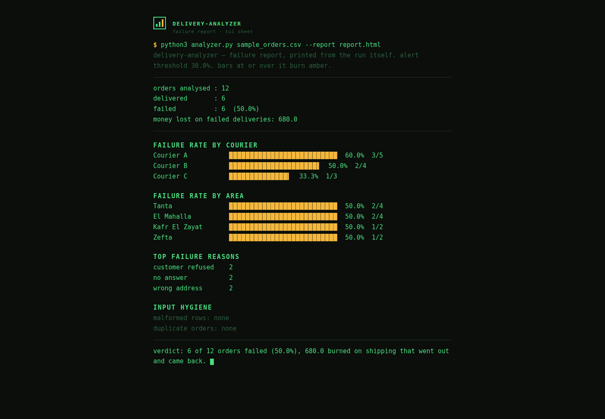

# Delivery Analyzer

Small tool, one job: you give it a CSV of orders, it tells you where your deliveries are dying.

Most COD stores I talk to know their failed-delivery rate "is high". Almost none can tell me which courier, which area, or which reason is doing the damage. Without that split, every fix is a guess.

## What it does

- Failure rate overall, and the money burned on failed parcels (shipping out + return)
- Failure rate per courier, so a bad courier stops hiding inside a good average
- Failure rate per area, so problem zones get confirmed before dispatch instead of after a return
- Failure reasons ranked, so you fix the biggest leak first
- Input hardening: required columns are checked up front, malformed rows are reported with their row number and reason (printed and in the JSON), and duplicate order ids are reported and counted once, never swallowed quietly

## Run it

```bash
python3 analyzer.py sample_orders.csv
python3 analyzer.py sample_orders.csv --json report.json
python3 analyzer.py sample_orders.csv --report report.html
python3 analyzer.py sample_orders.csv --strict
```

`--report` writes a standalone HTML report styled as what it is: the terminal run, printed. One typeface (JetBrains Mono), the literal command that produced it at the top, and the failure charts drawn in block characters (▁▂▅█), the same artifact the CLI prints, not a dashboard costume over it. Bars at or over the alert threshold burn amber; red is reserved for system errors and never appears. No JavaScript; the only external file is the font. `--strict` still prints and writes everything, but exits with code 2 when the input had malformed or duplicate rows, which is what a scheduled job wants. Without it the exit code stays 0 and the problems are only reported.

No dependencies. Python 3 only.

## Configuration and logging

Every run logs to a file. The defaults can be changed in the environment:

| Variable | Default | Meaning |
|---|---|---|
| `ANALYZER_LOG_FILE` | `analyzer.log` | Log file path (`--log` overrides it) |
| `ANALYZER_ALERT_PCT` | `30` | Failure rate at or above which a bar burns amber in the HTML report |

## Input format

```csv
order_id,courier,area,status,failure_reason,shipping_out,shipping_return
1001,Courier A,Tanta,failed,customer refused,60,60
```

`status` is `delivered` or `failed`. Anything else lands in the malformed list, along with empty courier or area, and shipping values that are not numbers or are negative. The sample file is fake data, 12 orders, just enough to see the shape of the output.

## Tests

```bash
python3 tests/test_analyzer.py
```

Nineteen checks covering the original maths, column validation, malformed and duplicate handling, the JSON and HTML reports, the log file, and strict mode exit codes.

## Why I built it

This is the first step of every ops audit I run. Ten minutes with this report replaces a week of arguing from gut feeling.

## Screenshots



The HTML report the analyzer generates for the sample orders file:
50.0% failed, drawn in block characters. All data on this screen is
the fictional sample data shipped with the tool.
